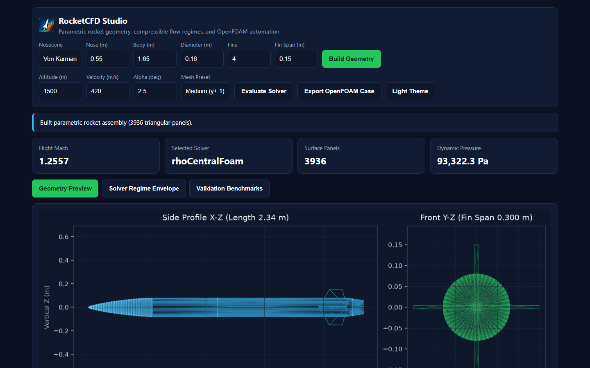
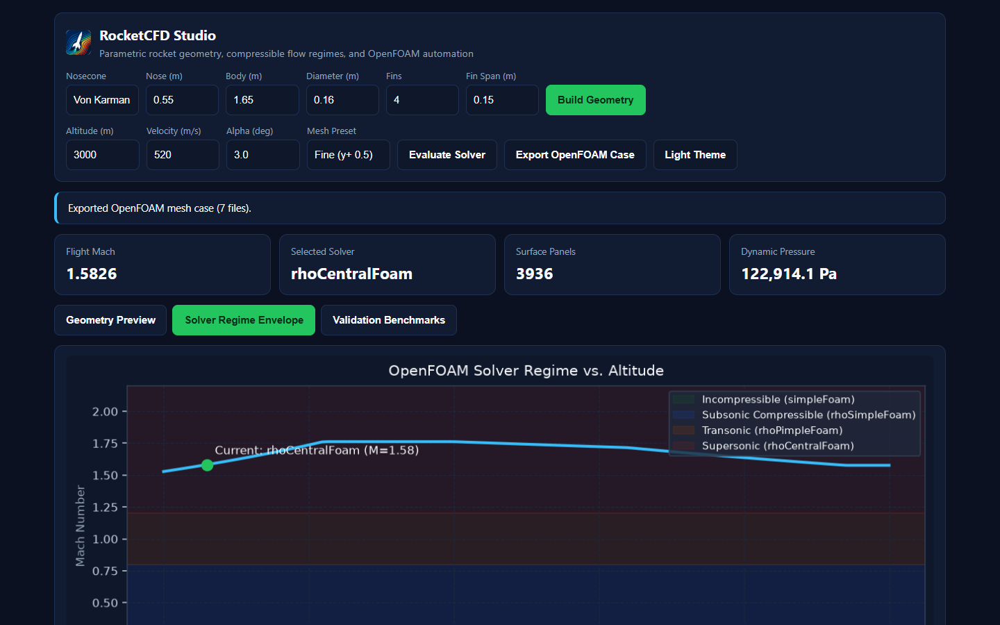

  
  <h1>RocketCFD</h1>
  
Automated parametric rocket aerodynamics, flight envelope solver selection, and OpenFOAM case generation studio.

## Download

| Platform | Download | Setup Guide |
| :--- | :--- | :--- |
| Windows (64-bit) | [RocketCFD-Windows.exe](https://github.com/DontKwo/RocketCFD/releases/latest/download/RocketCFD-Windows.exe) | [Windows Guide](docs/INSTALLATION.md#windows) &bull; [OpenFOAM WSL2](docs/OPENFOAM_INSTALLATION.md#windows) |
| macOS (Apple Silicon) | [RocketCFD-macOS.zip](https://github.com/DontKwo/RocketCFD/releases/latest/download/RocketCFD-macOS.zip) | [macOS Guide](docs/INSTALLATION.md#macos) &bull; [OpenFOAM macOS](docs/OPENFOAM_INSTALLATION.md#macos) |
| Linux (x86_64) | [RocketCFD-Linux.tar.gz](https://github.com/DontKwo/RocketCFD/releases/latest/download/RocketCFD-Linux.tar.gz) | [Linux Guide](docs/INSTALLATION.md#linux) &bull; [OpenFOAM Linux](docs/OPENFOAM_INSTALLATION.md#linux) |

## Screenshots

| Parametric Geometry Preview | Solver Regime Envelope |
| :---: | :---: |
|  |  |

## How to Use

1. Download the executable for your operating system from the [Download](#download) table above and follow the [Desktop Installation Guide](docs/INSTALLATION.md).
2. *(Optional)* Follow the [OpenFOAM Installation Guide](docs/OPENFOAM_INSTALLATION.md) if you plan to run full live 3D CFD solves locally or in WSL2.
3. Launch RocketCFD Studio to configure nosecones, body tubes, fins, and boattails, preview engineering dimensions, evaluate US Standard Atmosphere flight conditions (`simpleFoam` through `rhoCentralFoam`), review analytical benchmarks, and export ready-to-run OpenFOAM case directories.

## Key Features

- **Parametric Rocket Mesh Builder**: Build conical, tangent-ogive, or von Karman nosecones paired with fins, body tubes, and boattails.
- **Automated Mach Regime Classification**: Maps altitude, airspeed, and 1976 US Standard Atmosphere properties to `simpleFoam`, `rhoSimpleFoam`, `rhoPimpleFoam`, or `rhoCentralFoam`.
- **Boundary Layer & Mesh Presets**: Sizes `snappyHexMesh` background grids, refinement levels, and target $y^+$ first-layer thickness from flat-plate theory and Sutherland's law.
- **OpenFOAM Dictionary Exporter**: Writes complete `system/`, `constant/triSurface/`, and `0/` case directories alongside analytical validation benchmarks (`Sphere`, `Flat Plate`, `NACA 0012`, `Slender Cone`, `Apollo CM`).

## Safety & Disclaimers

- **Official `main` Releases Only**: Download executables strictly from `DontKwo/RocketCFD` (`main` / official [Releases](https://github.com/DontKwo/RocketCFD/releases/latest)). Do **not** download forked releases unless you have verified the source code yourself; only official `main` releases are maintained by the author.
- **OS Security Prompt Discretion**: Independent builds may trigger Windows SmartScreen or macOS Gatekeeper warnings. Review the [Desktop Installation Guide](docs/INSTALLATION.md) and bypass security prompts strictly at your own discretion.
- **AS-IS & Engineering Notice**: Provided "AS IS" under the [MIT License](LICENSE), without warranty of any kind. CFD outputs and OpenFOAM configurations are engineering estimates, not certified flight-safety approvals.

## Documentation

### User Documentation
- [User Guide](docs/USER_GUIDE.md)
- [Desktop Installation Guide](docs/INSTALLATION.md)
- [OpenFOAM Installation Guide](docs/OPENFOAM_INSTALLATION.md)
- [Frequently Asked Questions](docs/FAQ.md)

### Developer Documentation
- [Developer Guide](docs/DEVELOPMENT.md)
- [uv Installation Guide](docs/UV_INSTALLATION.md)

### AI, Mathematical Proof & Technical Documentation
- [AI Agent Reference](AGENTS.md)
- [Theoretical Background](docs/THEORY.md)
- [Validation Traceability](docs/VALIDATION.md)

### Legal & Security Policies
- [Security Policy](SECURITY.md)
- [Third-Party Notices](THIRD_PARTY_NOTICES.md)
- [MIT License](LICENSE)
